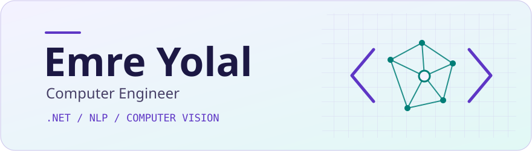

<picture>
  <source media="(prefers-color-scheme: dark)" srcset="./profile/banner-dark.svg">
  
</picture>

### 👋 Hi, I'm Emre

I build web apps with **.NET** and explore what machine learning can learn from text and images. I'm pursuing an **MSc in Information Systems Engineering**.

[💼 LinkedIn](https://www.linkedin.com/in/esyolal/) · [✉️ Email](mailto:esyolal@gmail.com) · [𝕏 X](https://twitter.com/esyolal) · [⌨️ HackerRank](https://www.hackerrank.com/esyolal)

## 🚀 Featured projects

**🩻 [CheXpert Report Decision Support](https://github.com/esyolal/CheXpert-Report-Decision-Support-System)**  
Fine-tunes ClinicalBERT to identify multiple findings in chest radiology reports.  
`ClinicalBERT` · `NLP` · `Multi-label classification`

**🛰️ [Earthquake Damage Detection](https://github.com/esyolal/earthquake-damage-detection-cnn-vs-transformers)**  
Compares CNNs and Vision Transformers for detecting building damage in post-earthquake imagery, with a follow-up experiment using SimCLR pretraining.  
`Computer vision` · `CNNs` · `Vision Transformers` · `SimCLR`

**🛠️ [BlogApp](https://github.com/esyolal/BlogApp-ASP.NET-Core-Mvc)**  
A blog application built with ASP.NET Core MVC as my full-stack bootcamp capstone.  
`C#` · `ASP.NET Core MVC`

[Explore all repositories →](https://github.com/esyolal?tab=repositories)

## 🔬 Research interests

- **Text** · Stress, sentiment, and hate speech detection with transformer models such as BERT, T5, and BART.
- **Images** · Microscopic image analysis and CNN-based image classification.

## 🧰 Toolbox

**.NET & data** · `C#` `.NET` `ASP.NET Core MVC` `SQL Server` `PostgreSQL`  
**Web** · `React` `Redux` `JavaScript` `Node.js` `Express` `HTML` `CSS` `Bootstrap`  
**Machine learning** · `Python` `PyTorch` `TensorFlow` `Jupyter` `Anaconda`
